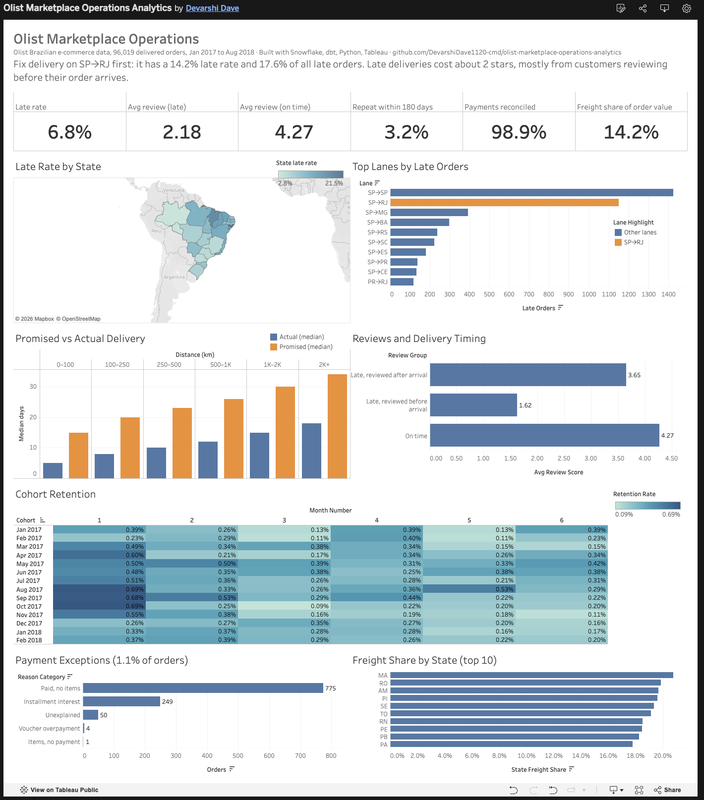
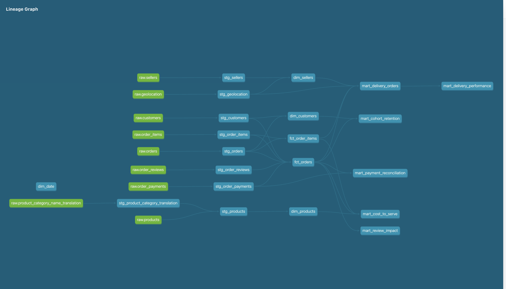
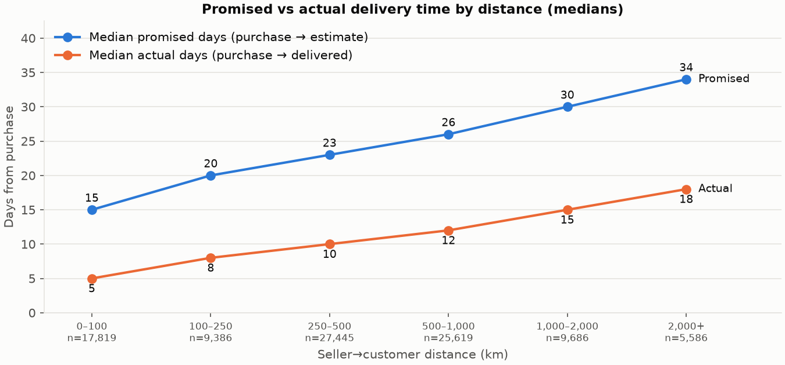
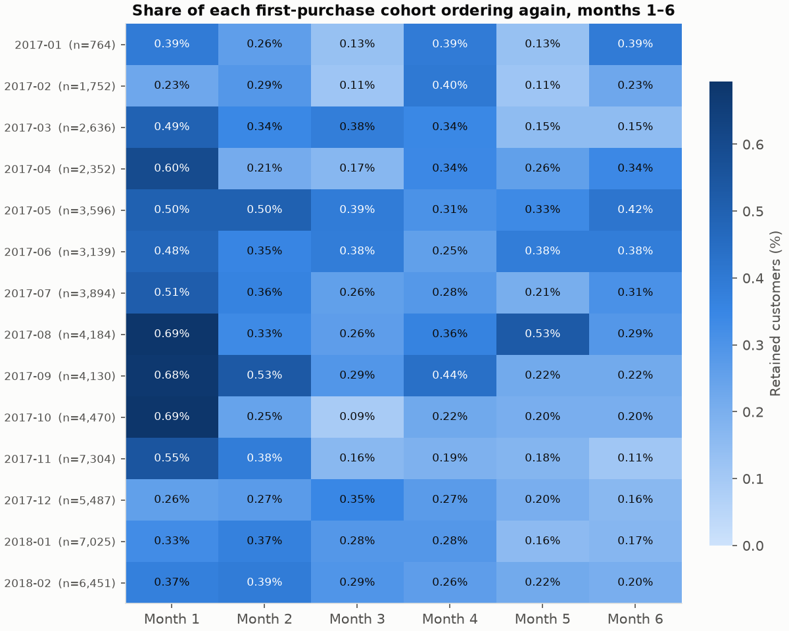

# Olist Marketplace Operations Analytics

📊 **Dashboard:** https://public.tableau.com/app/profile/devarshi.dave8755/viz/OlistMarketplaceOperationsAnalytics/Dashboard1

**Fix delivery on SP→RJ first: it has a 14.2% late rate and produces 17.6% of all late orders. Late deliveries cost about 2 stars, mostly from customers who review before their order arrives.**

An end-to-end analysis of ~100K real orders from Olist, a Brazilian e-commerce marketplace. Raw CSVs are loaded into **Snowflake**, modeled into a star schema with **dbt**, analyzed in **Python**, and presented in a **Tableau Public** dashboard.



---

## At a glance

| Question | Answer |
|---|---|
| How often are orders late? | **6.8%** of 96,019 delivered orders (95% CI 6.64%–6.96%) |
| What drives lateness? | Distance and lane. The late rate rises from 4.5% (under 100 km) to 12.1% (over 2,000 km). **SP→RJ + SP→SP = 39.5%** of late orders |
| Do late orders get worse reviews? | Yes: **2.18 vs 4.27 stars** (difference −2.09, 95% CI −2.14 to −2.04) |
| Why so much worse? | 72.6% of late customers answered the review **before delivery**. They averaged 1.62 stars, vs 3.65 for those who answered after arrival |
| Do late orders reduce repeat buying? | No measurable effect: 2.67% vs 3.20% repeat within 180 days (95% CI −1.02 to +0.07 pts, p = 0.081) |
| How many customers come back? | Very few: about **0.5%** in month 1 and 0.2–0.4% in months 2–6 |
| Do payments tie out? | **98.9%** of orders match items + freight to within BRL 0.01. BRL 163K was paid on 775 orders with no items |
| What share of order value is freight? | **14.25%** overall. Highest in the North/Northeast (MA 20.8%), lowest in SP (12.2%) |

---

## Business questions

1. **Delivery operations:** How often do orders arrive later than promised, and what drives it (seller, region, shipping lane, distance)?
2. **Customer impact:** Do late deliveries lower review scores and repeat purchases?
3. **Retention:** How many customers come back, and how does that differ by first-order experience?
4. **Finance reconciliation:** Do payments tie out to item prices plus freight? Where don't they, and why?
5. **Cost to serve:** What share of order value goes to freight, by region and category?

---

## Data and credit

- **Source:** [Brazilian E-Commerce Public Dataset by Olist](https://www.kaggle.com/datasets/olistbr/brazilian-ecommerce) on Kaggle, published by Olist (license: CC BY-NC-SA 4.0).
- **Contents:** 9 CSVs (orders, items, payments, reviews, customers, sellers, products, geolocation, category translation) covering ~99K orders from 2016–2018.
- **Raw data is not in this repo.** Download it from Kaggle into `data/raw/` (git-ignored).
- **Analysis window:** orders purchased **2017-01-01 to 2018-08-31**. This excludes thin months at both ends: 2016-09 to 2016-12, and 2018-09 to 2018-10.

All definitions (late, customer, repeat purchase, cohort, payment match, and so on) were written down before modeling, and are in [docs/analysis_definitions.md](docs/analysis_definitions.md).

---

## Data quality findings

From [docs/raw_profile.md](docs/raw_profile.md) (raw profile) and [docs/staging_counts.md](docs/staging_counts.md):

| Issue | Count | How it's handled |
|---|---:|---|
| `customer_id` is one per order; the person is `customer_unique_id` | 99,441 ids → 96,096 people | Customer = `customer_unique_id` everywhere |
| Orders not delivered (shipped, canceled, unavailable, …) | 2,963 | Excluded from delivery metrics |
| `delivered` status but no delivery date | 8 | Excluded from delivery metrics |
| Impossible timestamps (e.g. carrier pickup before purchase) | 189 orders (184 in the delivery base) | Excluded from delivery metrics only; count reported |
| `review_id` not unique | 789 ids on multiple orders | Latest review per order is used |
| Orders with 2–3 reviews / no review | 547 / 768 | Latest review kept / excluded from review analysis |
| Geolocation duplicate rows | 261,831 of 1,000,163 | Median lat/long per zip prefix |
| Geolocation points outside Brazil | 42 | Dropped before taking the median |
| Customer zips missing from geolocation | 157 zips (278 customers) | Distance left null |
| Orders with payments but no items | 775 | Flagged in reconciliation (dbt warn-level test) |
| Products with no category | 610 | Category = `unknown` |

---

## Pipeline

```
Kaggle CSVs ──► Snowflake RAW ──► dbt STAGING ──► dbt CORE (star schema) ──► dbt ANALYSIS (marts) ──► Python notebook
   (9 files)     (9 tables)       (9 models)      dim_* + fct_orders,          (6 marts)                  │
                                                  fct_order_items                                         ▼
                                                                                  dashboard_data/*.csv ──► Tableau Public
```



| Layer | Schema | What it holds | Tests |
|---|---|---|---|
| Raw | `OLIST.RAW` | 9 tables, original columns, typed; row counts match the CSVs | — |
| Staging | `OLIST.STAGING` | 9 cleaned models: one latest review per order, median geolocation per zip, analysis flags | Row counts match raw |
| Core | `OLIST.CORE` | `dim_customers`, `dim_sellers`, `dim_products`, `dim_date`, `fct_orders`, `fct_order_items` | Grain, keys, no fan-out |
| Analysis | `OLIST.ANALYSIS` | Delivery, review impact, cohort retention, reconciliation, cost to serve | Grain, keys, row counts |

**dbt tests: 46 in total.** That is 43 generic tests (17 not_null, 9 unique, 9 relationships, 5 accepted_values, 3 unique_combination) and 3 singular tests. The last full `dbt build` ran 21 models and 46 tests: 45 passed and 1 warned.

The one warning is deliberate: 775 orders have payments but no items (603 unavailable, 164 canceled, 8 other).

---

## Findings

### 1. Delivery: 6.8% late, concentrated on a few lanes
- **6.8%** of 96,019 delivered orders arrived after the estimated date. The median order arrived **12 days early**.
- **Distance matters.** The late rate climbs from **4.5%** (0–100 km) to **12.1%** (2,000+ km).
- **The buffer doesn't scale.** Estimates include padding, but the median buffer stops growing at **14 days** beyond 500 km. Meanwhile the slowest 10% of deliveries keep slowing: their 90th-percentile time rises from 12 to 35 days.
- **Rate vs count.** The worst late *rates* are long Northeast lanes (SP→AL 23.9%, MA→SP 20.2%, SP→MA 19.1%). The most late *orders* come from two high-volume lanes: **SP→SP (1,426 late, 21.8%)** and **SP→RJ (1,152 late, 17.6%)**. SP→RJ is high on both lists.



### 2. Customer impact: late orders cost about 2 stars
- Among 54,770 reviewed first orders, late orders averaged **2.18 stars vs 4.27** on time (Mann–Whitney p < 1e-300).
- 1–2 star reviews: **65.4% vs 9.5%**. The gap holds within purchase month (CMH odds ratio 17.4).
- **Timing explains most of the gap.** Olist sends the review survey before many late orders arrive. **72.6%** of late customers answered before delivery, and they averaged **1.62 stars**. Late customers who answered after delivery gave **3.65**.
- **Repeat purchase** shows no measurable effect: 2.67% (late) vs 3.20% (on time), p = 0.081.

### 3. Retention: almost everyone buys once
- Across 14 monthly cohorts (57,184 customers), only **0.48%** return in month 1, and 0.23–0.36% in months 2–6.
- Because repeat buying is so rare, retention can't separate good from bad first experiences at this sample size.



### 4. Finance: payments reconcile for 98.9% of orders
| Category | Orders | Payment value (BRL) |
|---|---:|---:|
| Matches (within BRL 0.01) | 98,362 | 15,793,088 |
| Payment without items | 775 | 162,592 |
| Installment interest (likely) | 249 | 37,130 |
| Unexplained | 50 | 15,814 |
| Voucher overpayment (likely) | 4 | 249 |
| Items without payment | 1 | — |

"Installment interest" and "voucher overpayment" are consistent explanations, not proven causes. The 775 payment-without-items orders are almost all unavailable or canceled, so finance should confirm they were refunded.

### 5. Cost to serve: freight is 14.25% of order value
- Freight share is highest in **MA (20.8%), RO, AM, PI and SE (~19–20%)** and lowest in **SP (12.2%)**.
- Three of the five worst late-rate states (MA, PI, SE) also have top-5 freight share. Across all states the correlation is weak (Spearman ρ = 0.28, p = 0.19).
- By category: christmas_supplies 26.8%, signaling_and_security 23.2%, food_drink 22.9%, electronics 22.8%.

Full analysis, tests and charts: [notebooks/olist_analysis.ipynb](notebooks/olist_analysis.ipynb).

---

## Recommendation memo

Recommendation: Fix delivery on the SP→RJ lane first, and test holding the review survey until orders arrive.

What I analyzed: 96,019 delivered orders purchased January 2017 to August 2018.

Delivery: About 1 in 15 orders (6.8%) arrived late. Estimates include a buffer, but it stops growing at about 14 days past 500 km while the slowest deliveries keep slowing, so the late rate climbs from 4.5% under 100 km to 12.1% beyond 2,000 km. SP→RJ has both a high late rate (14.2%) and high volume, producing 17.6% of all late orders despite being only about 440 km. SP→SP produces another 21.8%, but through volume, not poor performance (4.7% late).

Customer impact: Late first orders average 2.2 stars versus 4.3 on time. Most of the drop appears to come from customers reviewing while still waiting: 73% of late customers answered before delivery, averaging 1.6 stars; those answering after arrival gave 3.7.

Retention: Repeat buying is rare (about 3% within 180 days). Late customers repeated slightly less (2.7% vs 3.2%), but the difference isn't statistically clear.

Finance: Payments tie out for 98.9% of orders. BRL 163K was paid on 775 orders with no items, almost all canceled or unavailable; finance should confirm refunds.

Next steps: Investigate why SP→RJ runs late, A/B test delaying the survey, and audit the 775 orders.

---

## Dashboard

**[Olist Marketplace Operations on Tableau Public](https://public.tableau.com/app/profile/devarshi.dave8755/viz/OlistMarketplaceOperationsAnalytics/Dashboard1)**

The dashboard has these sections:
- **KPIs**
- **Late rate by state** (map) and **top lanes by late orders**, with SP→RJ highlighted
- **Promised vs actual delivery** by distance band, and **reviews by delivery timing**
- **Cohort retention** heatmap
- **Payment exceptions** and **freight share by state**

Tableau Public can't connect to Snowflake, so the dashboard reads [tableau/olist_dashboard_data.xlsx](tableau/olist_dashboard_data.xlsx). That file is built from the small exported tables in [dashboard_data/](dashboard_data/), so the dashboard keeps working after the Snowflake trial ends.

---

## How to reproduce

> **Note:** The Snowflake account used here is a **free trial (ends around Dec 2026)**. After that, the code is all you need to rebuild on any Snowflake account. The dashboard and the committed `dashboard_data/` files don't depend on Snowflake.

1. **Environment.** Create the conda env and install the packages:
   ```bash
   conda create -n olist python=3.11
   ```
   ```bash
   conda activate olist
   ```
   ```bash
   pip install pandas pyarrow jupyter matplotlib scipy statsmodels openpyxl dbt-snowflake "snowflake-connector-python[pandas]"
   ```
2. **Data.** Download the Kaggle dataset and put the 9 CSVs in `data/raw/`.
3. **Snowflake.** Create a warehouse `OLIST_WH` (XSMALL, auto-suspend 60 s) and a database `OLIST`.
   - Set up key-pair auth for your user.
   - Add an `[olist]` connection to `~/.snowflake/connections.toml`.
   - Keep the private key outside the repo.
4. **Load raw tables:**
   ```bash
   python scripts/00_load_raw.py
   ```
5. **Profile raw data** (optional, writes `docs/raw_profile.md`):
   ```bash
   python scripts/01_profile_raw.py
   ```
6. **Build and test the dbt models.** Add an `olist_dbt` profile to `~/.dbt/profiles.yml` using key-pair auth, then:
   ```bash
   cd olist_dbt && dbt build
   ```
   Expect 21 models to build, and 45 of the 46 tests to pass with 1 warning.
7. **Run the analysis:**
   ```bash
   jupyter nbconvert --to notebook --execute --inplace notebooks/olist_analysis.ipynb
   ```
8. **Export for Tableau:**
   ```bash
   python scripts/04_export_marts.py
   ```
   ```bash
   python scripts/05_export_summaries.py
   ```
   ```bash
   python scripts/06_build_tableau_workbook.py
   ```
   `05_export_summaries.py` re-checks 150 values against the recorded Step 6 results.

**Never commit credentials or raw data.** `.gitignore` excludes `data/raw/`, `*.p8`, `*.pem`, and `.env`.

---

## Tools

| Area | Tools |
|---|---|
| Warehouse | Snowflake (key-pair auth, XSMALL warehouse) |
| Modeling | dbt Core 1.12 (dbt-snowflake): staging → star schema → analysis marts, with tests |
| Analysis | Python 3.11: pandas, SciPy, statsmodels (Mann–Whitney U, two-proportion z, Newcombe CIs, Cochran–Mantel–Haenszel) |
| Visualization | matplotlib (notebook charts), Tableau Public (dashboard) |
| Workflow | Git/GitHub, conda, Jupyter |

Built with Claude Code as a coding assistant. The analysis definitions, decisions, and recommendation memo are my own.

## Repo layout

```
olist_dbt/          dbt project: staging, core and analysis models, tests
scripts/            load, profile, check and export scripts (00–06)
notebooks/          olist_analysis.ipynb: all Step 6 analysis
docs/               raw profile and row-count checks
images/             charts used in this README
dashboard_data/     small exported tables for Tableau (committed)
tableau/            Excel workbook used as the Tableau data source
```
